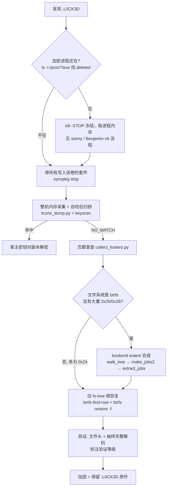

# 没有密钥也救回大半：C3RB3R (.L0CK3D) 勒索后靠 btrfs 写时复制残留恢复照片库

简体中文 | [English](README_EN.md)

**C3RB3R rescue without the key: btrfs copy-on-write extent retention.** 内存取密钥失败（NO_MATCH，结论可信），但 btrfs 的写时复制让大部分被「部分加密」的文件原文仍留在盘上——不需要密钥，也不需要付赎金。

2026 年 10 月这一波群晖 / 黑群晖勒索里，公开的成功案例都靠从内存里拿到会话主密钥。本案和 [lllong1377 的案例](https://github.com/lllong1377/c3rb3r-never-rebooted-still-no-key) 一样：机器从未重启，但加密进程早已退出，密钥扫不到。不同的是本案找到了**第二条路**：

**一句话结论：`0x25`（分段）和 `0x26`（仅前 1 MiB）这两种「原地部分加密」的文件，在 btrfs 上几乎都能不靠密钥救回来。** 加密器只改写了文件的一部分，btrfs 为这部分写了新 extent，但文件剩下的明文部分仍然引用原来的 extent——而 btrfs 只能整块释放 extent，于是**整个旧 extent（包括已经被加密那一段的原文）都原封不动地留在盘上**。把它读出来、和现存明文拼起来，就是原文件。

> **状态：已完成。** 最终合并去重后恢复 **17,893 / 24,142 个文件（74.1%）、约 274 / 375 GiB（约 73%）**。明细见 [04 · 结果与局限](docs/04-results-and-limits.md)，视频修复见 [06](docs/06-video-repair.md)。

## 三十秒版本

- 黑群晖（Intel N5105 / 16 GB / DSM 7.2.1-69057 Update 1），btrfs，uptime 23 天，全程未重启。勒索信 `10/28 14:49` 起落地，最后一批加密 `10/28 ~20:02`，`10/29 ~23:20` 才开始处置——**相隔约 27 小时，加密进程早已不在**。
- 整机内存 15.86 GiB 经 `/proc/kcore` 直接流式拉回分析机（NAS 上不落盘），约 45 亿个候选、全偏移扫描 4 分 45 秒，**NO_MATCH**。扫描器先用「埋入合成密钥」的自检证明自己能找到。
- 页脚普查目标照片库 24,142 个加密文件：`0x26` 10,220 个、`0x25` 7,197 个、`0x24` 6,725 个。**前两种是原地部分加密，正是 btrfs 能救的那一类。**
- 遍历当前 fs tree、找出仍被引用的攻击前 extent、按整个 extent 读回被加密的那几段：`0x26` **10,200 / 10,220** 完整、`0x25` **7,071 / 7,197** 完整 + 102 个部分；`0x24` 只有 117 / 6,725。
- 部分恢复的视频大多是丢了 `moov` 索引而打不开：搜回索引、逐帧校验、无损跳过坏段后，**47 个可完整播放**（保留时长中位数约 98%），另 35 个用 Synology Photos 的低画质转码版代替。
- 合并去重（bookend 原件 → 修复视频 → 旧树根原件 → 转码版）：**17,893 / 24,142 个文件、约 274 GiB**。没救回的 6,249 个几乎都是 ≤1 MiB 的整文件加密小文件。
- 抽 40 张恢复图片做完整解码 + 目视，40/40 通过；抽 8 个完整恢复的视频逐轨道完整解码，8/8 通过；所有修复版视频逐轨道完整解码通过。这是**格式级验证**，不是与原始文件 SHA 一致——我们没有原始摘要。

## 已验证可用路径

下一个受害者可以按这张表逐条判断。完整命令在 [00 · 操作手册](docs/00-runbook.md)。

| # | 路径 | 前提 | 工具 / 命令 | 本案怎么验证的 | 本案结果 | 状态 |
|---|---|---|---|---|---|---|
| 1 | 判断加密进程是否还在 | 能登录 NAS | `ls -l /proc/*/exe 2>/dev/null \| grep deleted`，逐个看 `cmdline` | 唯一的 deleted 可执行是引导器的 busybox `inetd`，不是加密器 | 加密器已退出 → 内存路线价值很低 | **已验证：本案无效** |
| 2 | 整机内存 → 扫会话主密钥 | root；最好进程还在 | `kcore_dump.py`（`/proc/kcore` → LiME，经 SSH 流式）+ `keyscan.c` | 先跑埋钥自检，命中唯一且偏移正确；0 不可读页 | 15.86 GiB，NO_MATCH | **方法已验证可用；本案结果无效** |
| 3 | 页脚普查，按模式定预期 | 能读 `.L0CK3D` | `collect_footers.py` + 汇总 | 24,142 个文件全部解析，会话标记唯一 | `0x26`/`0x25` 占文件数 72%、字节数 99%，有救 | **已验证，必做** |
| 4 | 立刻停掉往该卷写数据的套件 | DSM 管理权限 | `/usr/syno/bin/synopkg stop <包名>`（不在 sudo 的 PATH 里，要写全路径） | 停后卷上无新写入 | 停了 Photos / Drive / Cloud Sync / Download Station / Surveillance Station | **已验证** |
| 5 | 对未挂载的底层 LV 跑 `btrfs restore` | DSM 的 btrfs 跑在 `cachedev_N` 上 | 目标用 `/dev/mapper/vgN-volume_N`，不用 `cachedev_N`；只读；输出到**另一个卷** | 对 cachedev 报「is currently mounted」拒绝；对 LV 正常 | 可用 | **已验证有效** |
| 6 | 旧 fs-tree 根恢复（子卷指针已被覆盖时） | 卷上还有攻击后不久的旧树块 | `btrfs-find-root -a -o SUBVOL_ID LV` → `btrfs restore -D -v -i -f ROOT_BYTENR --path-regex …` 先 dry-run；用 `btrfs subvolume find-new` 把 generation 对上时间 | 恢复结果逐个查文件头 | 3 个约 14:55 的根：**2,442 个文件 / 19.9 GiB** 头部校验通过（另有 1,075 个空文件、554 个已被覆盖） | **已验证有效** |
| 7 | **核心：bookend extent 合成** | btrfs、`0x25`/`0x26`、写入方已停 | `walk_tree.py` → `make_jobs2.py` → `extract_jobs.py` | 拼接前确认读回内容≠现存密文；拼接后查文件头；抽样完整解码 | `0x26` 99.8%、`0x25` 98.2% 完整（17,271 个） | **已验证有效** |
| 7b | 孤儿叶子补 `0x24` | 旧叶子还在、旧 extent 未被复用 | `parse_leaves.py`（孤儿叶子的精确引用，与 7 合并） | 只能查文件头 | `0x24` 只有 290/6,725 个找到旧引用；117 个通过头部检查 | **部分有效** |
| 8 | 恢复结果验证 | — | `verify_restored.py`（文件头）+ macOS `sips`/ImageIO 完整解码 + 目视 | 40/40 解码通过 | 等级 = 格式级，**不是原始 SHA** | **已验证（格式级）** |
| 9 | 部分恢复视频修复 | 视频 `moov` 在尾段/头段丢失 | `tools/video/`：`videofix.py`（搜回 `moov`）→ `headerfix.py`（重建文件头）→ `finish_videos2.py` + `splicevideo.swift`（跳坏段无损拼接）→ `checkvideo.swift` | 逐轨道完整解码 | 47 个可完整播放，保留时长中位数约 98% | **已验证有效** |
| 10 | Synology Photos 转码版兜底 | `@eaDir` 里有 `SYNOPHOTO_FILM_*` | 同 7，目标换成转码文件 | 完整解码 | 转码版 84/89 取回，用于 35 个修不好的视频 | **已验证有效** |

**试过但没用的：**

| 路径 | 结果 | 原因 |
|---|---|---|
| soimy 公开的 48 字节会话候选 | 无效 | 本案会话标记 `0b5c8e4c`，与 `ce35a593` 不同，不同会话不同密钥 |
| `btrfs restore -t <旧 root tree> -r SUBVOL_ID` | 0 个文件 | 旧 root tree 里指向该子卷的 ROOT_ITEM 所指块已被覆盖；要直接用 `-f` 指定 fs-tree 根（路径 6） |
| 对已挂载的 `/dev/mapper/cachedev_N` 跑 `btrfs restore` | 拒绝执行 | 「is currently mounted」；改用底层 LV（路径 5） |

## 决策流程

文字版：**进程在 → 先冻结取内存；不在 → 先停写入、再取整机内存碰运气；扫不到 → 页脚普查；btrfs + 部分加密 → bookend 合成；全加密小文件 → 旧树根 / 孤儿叶子，能救多少算多少。**

顺序要点：**停写入要尽早**。bookend 方法依赖旧 extent 不被搬动或复用，任何往该卷大量写入的程序（相册索引、同步、下载、录像）都会缩小可救范围。内存采集本身不写目标卷，可以和停写入并行。

## 和已有仓库的不同

| 仓库 | 内容 | 与本案的关系 |
|---|---|---|
| [soimy/c3rb3r-rescue](https://github.com/soimy/c3rb3r-rescue) | 首个成功案例：内存取钥 + 格式分析 + 解密器 | 页脚格式、分段规则、验证等级用语均以它为准 |
| [lllong1377/c3rb3r-never-rebooted-still-no-key](https://github.com/lllong1377/c3rb3r-never-rebooted-still-no-key) | 未重启但进程已退出，内存全扫 0 命中 | 本案前半段与它一致；它的 btrfs 卷 100% 占满，所以没有后半段 |
| **本仓库** | 内存同样失败 → **btrfs CoW extent 残留恢复** | 新增：不靠密钥救回部分加密文件的方法与工具 |

lllong1377 的仓库里写过一句「如果卷还有大量空闲块，这条思路才值得一试」。本案正好是那个条件（约 2.3 TiB 未分配），而且发现被部分加密的文件根本不需要去空闲块里雕刻——旧 extent 仍是**已分配**状态。

## 本案事实

| 项目 | 值 |
|---|---|
| 平台 | 黑群晖物理机，Intel N5105，16 GB；引导器伪装 SA6400（`synology_epyc7002_sa6400`） |
| 系统 | DSM 7.2.1-69057 Update 1，内核 5.10.55+ |
| 存储栈 | md → LVM → flashcache-syno（DUMMY 模式）`cachedev_N` → btrfs；`space_cache=v2`、`auto_reclaim_space`、`syno_allocator` |
| 数据卷 | 约 7.26 TiB，已用约 4.9 TiB，**未分配约 2.3 TiB** |
| 运行时间 | uptime 23 天，感染前后从未重启 |
| 样本特征 | 会话标记 `0b5c8e4c`，加密模式 `0x20`，页脚布局与 soimy 一致；勒索信 `read-me3.txt` |
| 目标目录 | 一个用户的照片库（下称 `/volume1/homes/USER/Photos`），24,142 个加密文件，375 GiB（含页脚） |
| 密钥 | **未取得**（NO_MATCH） |
| 处置 | 停写入、取证、恢复到另一卷；未付赎金；原 `.L0CK3D` 全部保留 |

## 工具

全部只用 Python 3.8 标准库（NAS 上直接 `python3 -` 从 stdin 跑，不落盘），`keyscan.c` 在 macOS 分析机上编译（CommonCrypto）。每个脚本的输入、输出和只读保证见 [tools/README.md](tools/README.md)。

| 阶段 | 脚本 |
|---|---|
| 内存 | `kcore_dump.py`、`keyscan.c`、`make_selftest.py` |
| 普查 | `collect_footers.py` |
| btrfs 元数据 | `chunkmap.py`、`walk_tree.py`、`parse_leaves.py` |
| 任务与恢复 | `make_jobs2.py`（主用）、`make_jobs.py` / `build_plan.py`（早期版本，仅孤儿叶子）、`extract_jobs.py`、`btrfs_restore_run.sh` |
| 验证 | `verify_restored.py` |

## 文档

- [00 · 操作手册](docs/00-runbook.md)：按顺序可复制的命令，占位符替换即可
- [01 · 时间线与现场分诊](docs/01-timeline-and-triage.md)
- [02 · 内存采集与密钥扫描](docs/02-memory-capture-and-keyscan.md)：为什么这个 NO_MATCH 可信
- [03 · btrfs extent 残留恢复](docs/03-btrfs-extent-retention.md)：**本仓库的核心**，含原理图
- [04 · 结果与局限](docs/04-results-and-limits.md)：最终数字、验证等级、不声称什么
- [06 · 部分恢复视频的修复](docs/06-video-repair.md)：搜回 `moov`、逐帧校验、跳坏段拼接、重建文件头
- [05 · 加固](docs/05-hardening.md)

## 这份记录不能声称什么

- **不能声称拿到了密钥**，也不提供解密器。
- **不能声称恢复的文件与原文件逐字节一致。** 没有原始 SHA，验证停在「文件头」和「图像完整解码 + 目视」两级；视频只做了文件头检查。btrfs 数据校验和（csum tree）比对尚未做。
- **不能声称 `0x24` 可恢复。** 整文件加密会让旧 extent 失去全部引用而被释放、多半已被复用；本案只救回很小一部分，且只查了文件头。
- **不能外推到其他文件系统。** ext4 没有这种写时复制；btrfs 卷如果已被打满、做过 balance/defrag、或停写入太晚，可救范围会大幅缩小。
- 不包含受害者标识、内网地址、账号、真实路径、原始日志、密钥材料或任何恢复出的内容。

## 许可

代码（`tools/`）MIT；文档 CC BY 4.0。`decrypt_copy.py` 属于 soimy，本仓库不收录、不改授权，只在 [02](docs/02-memory-capture-and-keyscan.md) 里描述了一行改动。

## 致谢

页脚格式、分段规则和验证等级用语来自 [soimy/c3rb3r-rescue](https://github.com/soimy/c3rb3r-rescue)；「先自检再宣布没找到」与仓库结构借鉴 [lllong1377/c3rb3r-never-rebooted-still-no-key](https://github.com/lllong1377/c3rb3r-never-rebooted-still-no-key)。本仓库的 btrfs 解析按 btrfs 磁盘格式独立实现，未使用样本。
